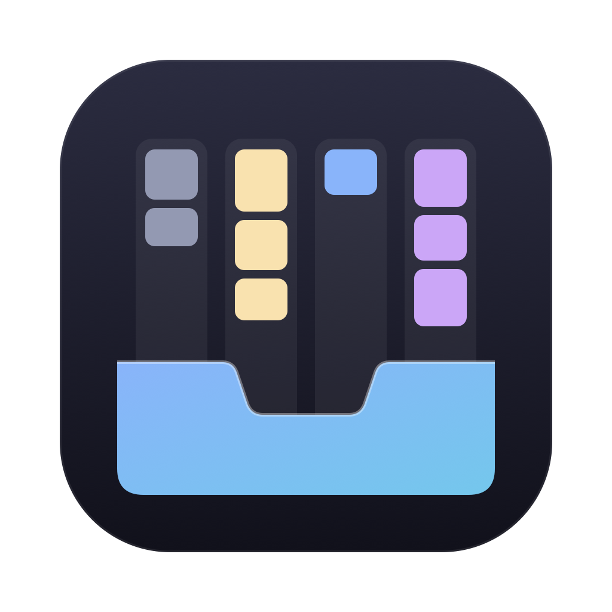

<p align="center"></p>

# gitbox

Your GitHub notifications as a board, in a native desktop window. gitbox reads them through the
[GitHub CLI](https://cli.github.com), so it holds no token of its own.

The board puts unread notifications in four lanes:

| Lane | Holds |
|---|---|
| Todo | Everything else: comments, subscriptions, state changes, CI. |
| Requested | Review requests. |
| Waiting on me | Mentions, team mentions, assignments, and activity on threads you opened. |
| Merged / Closed | Any notification whose PR or issue is merged or closed. |

A click on a card opens it in the browser. Each lane loads more cards as you scroll it. The filter
row narrows the board by repository, type, state, label, review count, review status, reason or
author, with a chip for each filter. The settings (⌘,) change the lane size, the auto-refresh, the
API query and more.

## Install

1. Install the GitHub CLI and sign in: `brew install gh`, then `gh auth login`.
2. Download the `.dmg` from the [releases](https://github.com/jaronoff97/gitbox/releases), open
   it, and drag Gitbox to Applications.
3. The app is not notarized yet, so macOS blocks it at first. Allow it under System Settings →
   Privacy & Security → "Open Anyway".

At its first start, gitbox checks that `gh` is installed, signed in, and can read notifications.
It shows the fix for a step that fails. Settings and the onboarding state are saved in
`~/.config/gitbox/state.json`.

## Develop

Needs Node 24 or later, or Bun 1.4 or later. `source bin/activate-hermit` puts both on your
`PATH`.

```bash
npm install
npm start            # opens the window (as "Gitbox Dev", with an inverted icon, on macOS); saving a .svelte file hot-reloads it
npm test             # headless test against a fake gh
npm run typecheck
npm run build        # dist/gitbox, and on macOS dist/Gitbox.app and a .dmg; needs Bun
```

A change to a `.ts` file needs a restart of `npm start`.

## Release

Releases come from [release-please](https://github.com/googleapis/release-please). Pull request
titles follow [Conventional Commits](https://www.conventionalcommits.org) (`feat: …`, `fix: …`;
`pr-title.yml` checks them), and PRs are squash-merged, so each title is a commit on `main`. Every
push to `main` updates a release PR with the next version and its changelog. Merging that PR bumps
`package.json`, writes `CHANGELOG.md`, tags `vX.Y.Z` and makes the GitHub release, and the release
workflow attaches the `.dmg` it builds on macOS.

To sign and notarize, set `CODESIGN_IDENTITY` (a Developer ID Application certificate) and
`NOTARY_PROFILE` (a `notarytool` keychain profile) when you run `npm run build`. `build.ts`
explains both.

Built with [gpuix-svelte](https://github.com/khromov/gpuix-svelte): Svelte 5 rendered by GPUI.
Icons are [Octicons](https://github.com/primer/octicons) (MIT).
